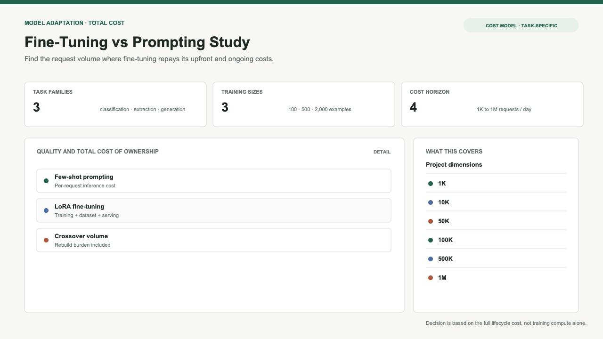
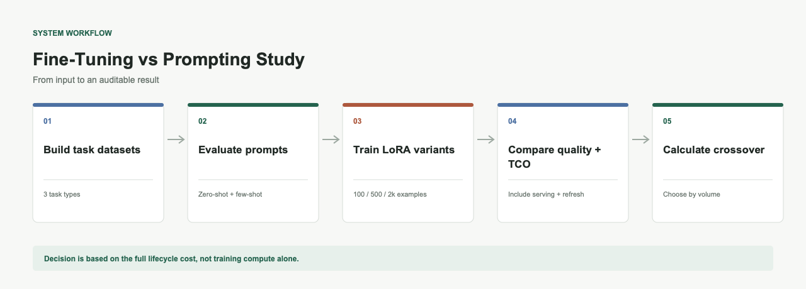

# Fine-Tuning vs Prompting Study

**When does fine-tuning beat a good prompt? Depends on volume.**

Three task types, LoRA fine-tuning against few-shot prompting, with the full cost of fine-tuning counted properly: training compute, building the dataset, serving a custom checkpoint, and rebuilding all of it every time the base model moves. What you want out of this is the crossover volume — below it, fine-tuning loses on money even when it wins on the benchmark.

Fine-tuning feels like the serious option, so teams reach for it and end up owning an artifact they have to rebuild every six months. Very few people have done the arithmetic.





## Quick Start

```bash
pip install -e ".[dev]"
ft-vs-prompt generate
ft-vs-prompt evaluate-prompting
ft-vs-prompt crossover
```

## Task Types

| Task | Type | Metric |
|------|------|--------|
| Classification | Sentiment, topic, intent | Accuracy, F1 |
| Structured Extraction | Contact info, order details | Exact match, partial match |
| Style-Constrained Generation | Formal rewrite, concise summary, technical docs | Qualitative (style adherence) |

## What's Compared

| Method | Training Data | Cost Structure |
|--------|-------------|----------------|
| Zero-shot prompting | None | Per-request API cost |
| Few-shot prompting (3 examples) | 3 hand-picked examples | Per-request API cost |
| LoRA fine-tuned (100 ex) | 100 labelled examples | Upfront training + GPU serving |
| LoRA fine-tuned (500 ex) | 500 labelled examples | Upfront training + GPU serving |
| LoRA fine-tuned (2000 ex) | 2000 labelled examples | Upfront training + GPU serving |

## What Gets Measured

### Quality
- Accuracy/F1 on held-out test set
- Exact match rate (extraction tasks)
- Quality delta between methods

### Cost (TCO)
- Training compute (GPU-hours × hourly rate)
- Dataset creation (labour hours × rate)
- Serving infrastructure (GPU instance 24/7)
- Retraining burden (every 6 months per base model update)
- Total cost at 1K, 10K, 100K, and 1M requests/day

### Latency
- p50 and p95 response times
- Prompting: API round-trip
- Fine-tuned: Local inference

## Cost Crossover

The key output is the crossover volume — the request volume at which fine-tuning becomes cheaper than prompting:

```
Below crossover: Prompting wins (pay per use, no infra)
Above crossover: Fine-tuning wins (amortized training, lower per-request cost)
```

The crossover is different for each task and depends on:
- Tokens per request
- Training GPU hours
- Dataset creation effort
- Serving infrastructure cost
- Base model update frequency

## Usage

### Generate datasets

```bash
ft-vs-prompt generate --output data --train-sizes 100,500,2000
```

### Evaluate prompting baselines

```bash
ft-vs-prompt evaluate-prompting --data-dir data --output results
```

### Run LoRA fine-tuning

```bash
ft-vs-prompt train --task classification --train-sizes 100,500,2000
```

### Compute crossover

```bash
ft-vs-prompt crossover --task classification
```

### Generate decision guide

```bash
ft-vs-prompt decision-guide --output docs
```

## Project Structure

```
├── src/ft_vs_prompt/
│   ├── cli.py                      # CLI
│   ├── data/generator.py           # Synthetic dataset generation (3 tasks)
│   ├── prompting/engine.py         # Few-shot prompt templates (genuine effort)
│   ├── training/lora.py            # LoRA training pipeline (3 sizes)
│   ├── eval/runner.py              # Evaluation framework
│   ├── analysis/reporter.py        # Charts, tables, crossover visualization
│   └── tco/model.py                # TCO model + decision guide
├── config/default.json             # Configuration
├── docker/                         # Docker + GPU support
├── docs/                           # Decision guide output
├── tests/                          # Unit tests
└── README.md
```

## Decision Guide

The generated `docs/decision_guide.md` covers:

- Crossover volumes by task
- When to choose prompting vs fine-tuning
- Hidden costs of fine-tuning
- Retraining burden calculation
- Quality vs cost trade-off framework

## License

MIT
